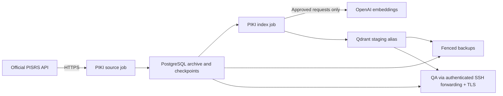

# PIKI staging architecture

**Proposed G2 target.** Run two permanent database containers on the existing PIKI Docker Engine and run a pinned Python release as separate host systemd jobs. This uses the existing container lifecycle and storage without moving shared Docker state. It keeps application credentials, scheduling and backup control in systemd and avoids an application container, scheduler service, message broker, web application, and reverse proxy. Switch this decision only if effective Docker storage or port isolation fails the G0 review. Host baseline and unresolved readiness are in [ENV](PIKI-PISRS-ENV.md).

## Components and boundaries

| Component | Candidate contract |
|---|---|
| Host | PIKI Ubuntu 26.04 LTS, x86-64, existing Docker Engine 29.9.x and packaged containerd. Reconfirm effective state and collisions before G3. No shared daemon config changes. |
| PostgreSQL | PostgreSQL 18.x, current security patch at image selection. Use official image by immutable digest. Named container `pisrs-piki-pg`, DB `pisrs_staging`, schema `pisrs`. Pin explicit `PGDATA` inside a bind to avoid an anonymous default data volume, and use the same major for dump/restore tooling. [PostgreSQL versions](https://www.postgresql.org/support/versioning/) |
| Qdrant | Qdrant 1.20.x, current security patch at image selection, official image by immutable digest. Named container `pisrs-piki-qdrant`, one logical staging index with one temporary shadow collection only for replacement. Single node, on-disk vectors and HNSW, sharding/replication 1. No implicit telemetry. Validate optional scoped JWT and snapshot support against the pinned version. [Qdrant releases](https://github.com/qdrant/qdrant/releases) |
| Application | CPython 3.14.x from the supported host interpreter, one reproducible hashed dependency lock/wheelhouse after G2. Evaluate requests 2.x, psycopg 3.x, BeautifulSoup 4.x and the selected tokenizer on that interpreter in the first G3 build. This is a target for the rewrite. The historical package requires 3.12. No nested Docker or paid calls in dependency checks. |
| Jobs | `pisrs-piki-source.service/.timer`, `pisrs-piki-index.service/.timer`, `pisrs-piki-backup.service/.timer` and separately invoked `pisrs-piki-restore` procedure. Database containers are controlled by reviewed `pisrs-piki-stores.service`. Source and index run as different unprivileged accounts and can fail/restart independently. Shared backup fence and per-stage locks are database advisory locks with stable assigned keys. |
| Consumer access | Named test users via existing approved restricted SSH ingress and directed loopback forwarding. PG requires a SELECT-only QA role for approved views; Qdrant requires read-only collection-scoped access to the serving index, obtained only after G5 checks. Add no Engine endpoint, UI or anonymous route. Host key, user keys, tunnel restrictions and revocation need a staging operator decision. |
| Egress | PG and Qdrant are restricted to local endpoints. Source job may reach approved PISRS origin over verified TLS. Index job may reach the official embedding provider only once a valid paid plan is available. Backup job reaches only the approved encrypted recovery destination. Deployment operator uses approved image/package registries. |

## Network and files

One private Docker bridge `pisrs-piki-staging` for the two stores, plus Docker loopback publishes `127.0.0.1:15432` → PG 5432 and `127.0.0.1:16333` → Qdrant 6333. No published gRPC port. Review PG `pg_hba.conf` with ordered `hostssl` rules, source address as observed through Docker's port forwarding and explicit role/database allowlist. Do not assume a container sees the loopback source address. Qdrant requires API authentication and TLS. Use operator-issued staging certificates with verification of the approved hostname and CA through the tunnel. Verify the rules by allowed/denied connection tests, including from the bridge and external interfaces. Administrative credentials enter through protected mounts or credential loading, with environment/inspect output kept sanitized. Use separate system Unix users `pisrs-pg`, `pisrs-qdrant`, `pisrs-source`, `pisrs-index`, `pisrs-backup`. Bind container UIDs/GIDs to verified host ownership at image pin; neither application user belongs to the Docker group.

All paths are below `/data/pisrs-staging` unless explicitly system configuration. Docker image and storage root are shared with other applications and separately verified under `/data`.

| Relative path | Use and ownership |
|---|---|
| `releases/<commit>/`, `current`, `runtime/wheels/` | Immutable app venv/release, atomic deploy symlink and locked wheels/cache. Root-owned and service-readable. |
| `pg/data/`, `pg/conf/` | PG cluster including WAL in `pg/data/pg_wal`; versioned, reviewed configuration separately mounted read-only. PG UID only on data. |
| `qdrant/storage/`, `qdrant/snapshots/`, `qdrant/conf/` | Explicit storage/snapshot binds, configuration read-only. Qdrant UID only for live data and snapshots. |
| `secrets/<role>/` | Root private directories, per-unit `LoadCredential=` inputs or narrowly scoped container file mounts. JSON and argv carry no secrets. Runtime credentials created by systemd in its protected volatile credential directory. |
| `work/{source,index,backup}/`, `cache/{source,index}/`, `logs/{source,index,backup,pg,qdrant}/` | Separate owner-only scratch/cache/log directories. Bounded cleanup by role. Bind app `/tmp` and `/var/tmp` to per-job scratch in its namespace or use disconnected tmpfs for small runtime metadata, with all accumulation under `/data`. |
| `backup/<manifest-id>/`, `restore/<drill-id>/` | Encrypted capture and independent recovery workspace. Copy to approved separate failure domain. No live mounts in restore. |

System unit files and essential OS/network configuration may live under `/etc`. Full application/service logs live on `/data`; system journal holds unit lifecycle summaries. Disable default writable image volumes or map them explicitly, set bounded Docker logging under verified `/data`, and map any writable database temp paths under project scratch or memory-only bounded mounts. No `StateDirectory=` fallback onto `/`. Mount dependencies use `RequiresMountsFor=/data/pisrs-staging`. Per-role systemd hardening includes `NoNewPrivileges`, `ProtectSystem=strict`, `ProtectHome`, `UMask=0077`, private mount namespaces and minimal `ReadWritePaths`. Enforce network confinement using confirmed host policy rather than one brittle resolved-IP rule. [systemd execution environment](https://www.freedesktop.org/software/systemd/man/latest/systemd.exec.html) · [Docker data root](https://docs.docker.com/engine/daemon/)

## Proposed resource and cadence envelope

Use PIKI's measured 8 logical CPUs and 46 GiB RAM for sizing. Start controlled pilot caps at PG 8 GiB/3 CPUs, Qdrant 8 GiB/3 CPUs, source 3 GiB/2 CPUs, index 4 GiB/2 CPUs, backup or restore 6 GiB/2 CPUs. Enforce via cgroups and fence restore from builds/backup. Reserve 20% of `/data` for host and existing services. Include peak WAL, decompression, index shadows, offline backup capture and isolated restore in the budget. Treat these as proposed pilot values. Tune on measured read/write rates, content sizes, vector count and latency before acceptance. Set per-run time, request, byte and token bounds and persist resumable work.

Aim for a source timer at 07:30 Europe/Ljubljana after the reported morning refresh, index eligibility check at 15:00 and fenced backup at 19:00, all persistent with missed-run handling. Exact source window, quotas and effective completion SLA are pending issuer and owner. Keep source runs bounded before backup fencing and record any overrun for operators. Timer recovery, readiness and verification are in [Operations](PIKI-PISRS-OPERATIONS.md).
