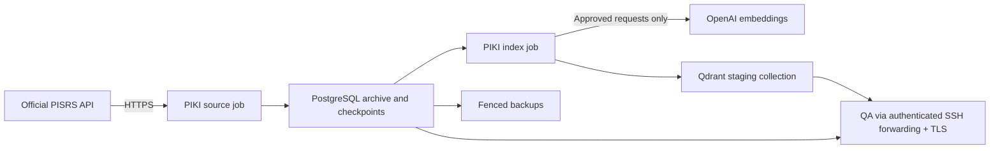

# PIKI staging architecture

**Proposed G2 target.** Run two permanent database containers on the existing PIKI Docker Engine and run one pinned Python release with three unprivileged one-shot jobs and one timer. This uses the existing container lifecycle and storage without moving shared Docker state. It keeps application credentials, scheduling and backup control in systemd and avoids an application container, scheduler service, message broker, web application, and reverse proxy. Switch this decision only if effective Docker storage or port isolation fails the G0 review. Host baseline and unresolved readiness are in [ENV](PIKI-PISRS-ENV.md).

## Components and boundaries

| Component | Candidate contract |
|---|---|
| Host | PIKI Ubuntu 26.04 LTS, x86-64, existing Docker Engine 29.9.x and packaged containerd. Reconfirm effective state and collisions before G3. No shared daemon config changes. |
| PostgreSQL | PostgreSQL 18.x, current security patch at image selection. Use official image by immutable digest. Named container `pisrs-piki-pg`, DB `pisrs_staging`, schema `pisrs`. Pin explicit `PGDATA` inside a bind to avoid an anonymous default data volume, and use the same major for dump/restore tooling. [PostgreSQL versions](https://www.postgresql.org/support/versioning/) |
| Qdrant | Qdrant 1.20.x, current security patch at image selection, official image by immutable digest. Named container `pisrs-piki-qdrant`, one physical staging collection updated under a PostgreSQL publication fence. Single node, on-disk vectors and HNSW, sharding/replication 1. No implicit telemetry. Validate least-privilege scopes against the pinned version. PostgreSQL is the backup and rebuild source. [Qdrant releases](https://github.com/qdrant/qdrant/releases) |
| Application | CPython 3.14.x from the supported host interpreter, one reproducible hashed dependency lock/wheelhouse after G2. Evaluate requests 2.x, psycopg 3.x, BeautifulSoup 4.x and the selected tokenizer on that interpreter in the first G3 build. This is a target for the rewrite. The historical package requires 3.12. No nested Docker or paid calls in dependency checks. |
| Jobs | `pisrs-piki-source.service`, `pisrs-piki-index.service`, and `pisrs-piki-backup.service`; one `pisrs-piki-source.timer`. After G5 activation, source OnSuccess starts index; source OnFailure starts backup; index OnSuccess and OnFailure start backup. Use one-shot services with `RemainAfterExit=no` and finite deadlines. Before G5, run supervised steps independently. Stage locks and saved heads remain independent. [systemd unit dependencies](https://www.freedesktop.org/software/systemd/man/latest/systemd.unit.html) |
| Consumer access | Named staging test users through the existing approved access path and a restricted read-only command in the same PIKI release. The command uses an approved query vector and date, checks the PG generation while holding the read fence and accesses loopback Qdrant with a scoped read-only credential. Admin and write APIs are never granted to QA. Direct Qdrant access would bypass the publication fence; keep the serving credential inside the restricted command and test that boundary before admitting users. No added server, portal or Engine change. |
| Egress | PG and Qdrant are restricted to local endpoints. Source job may reach approved PISRS origin over verified TLS. Index job may reach the official embedding provider only once a valid paid plan is available. Backup job reaches only the approved encrypted recovery destination. Deployment operator uses approved image/package registries. |

## Network and files

One private Docker bridge `pisrs-piki-staging` for the two stores, plus Docker loopback publishes `127.0.0.1:15432` → PG 5432 and `127.0.0.1:16333` → Qdrant 6333. No published gRPC port. Review PG `pg_hba.conf` with ordered `hostssl` rules, source address as observed through Docker's port forwarding and explicit role/database allowlist. Do not assume a container sees the loopback source address. Qdrant requires API authentication and TLS. Use operator-issued staging certificates with verification of the approved hostname and CA through the tunnel. Verify the rules by allowed/denied connection tests, including from the bridge and external interfaces. Administrative credentials enter through protected mounts or credential loading, with environment/inspect output kept sanitized. Use three named host service accounts, `pisrs-source`, `pisrs-index` and `pisrs-backup`. Separate numeric nonroot image UIDs/GIDs and verified bind ownership isolate the two stores without extra host login accounts. Ensure the effective UIDs neither collide with each other nor grant access to unrelated data. None of the three service accounts belongs to the Docker group. Runtime restart of the stores belongs to the existing Docker service with verified mount ordering and a reviewed restart policy. Avoid a project-specific store supervisor.

All paths are below `/data/pisrs-staging` unless explicitly system configuration. Docker image and storage root are shared with other applications and separately verified under `/data`.

| Relative path | Use and ownership |
|---|---|
| `releases/<commit>/`, `current`, `runtime/wheels/` | Immutable app venv/release, atomic deploy symlink and locked wheels/cache. Root-owned and service-readable. |
| `pg/data/`, `pg/conf/` | PG cluster including WAL in `pg/data/pg_wal`; versioned, reviewed configuration separately mounted read-only. PG UID only on data. |
| `qdrant/storage/`, `qdrant/conf/` | Explicit storage bind and read-only configuration. Qdrant UID alone writes live data. PostgreSQL backups supply rebuild material. |
| `secrets/<role>/` | Root private directories, per-unit `LoadCredential=` inputs or narrowly scoped container file mounts. JSON and argv carry no secrets. Runtime credentials created by systemd in its protected volatile credential directory. |
| `work/{source,index,backup}/`, `cache/{source,index}/`, `logs/{source,index,backup,pg,qdrant}/` | Separate owner-only scratch/cache/log directories. Bounded cleanup by role. Bind app `/tmp` and `/var/tmp` to per-job scratch in its namespace and keep accumulated data under `/data`. |
| `backup/<manifest-id>/`, `restore/<drill-id>/` | Encrypted capture and independent recovery workspace. Copy to approved separate failure domain. No live mounts in restore. |

System unit files and essential OS/network configuration may live under `/etc`. Full application/service logs live on `/data`; system journal holds unit lifecycle summaries. Disable default writable image volumes or map them explicitly, set bounded Docker logging under verified `/data`, and map any writable database temp paths under project scratch or memory-only bounded mounts. No `StateDirectory=` fallback onto `/`. Mount dependencies use `RequiresMountsFor=/data/pisrs-staging`. Per-role systemd hardening includes `NoNewPrivileges`, `ProtectSystem=strict`, `ProtectHome`, `UMask=0077`, private mount namespaces and minimal `ReadWritePaths`. Enforce network confinement using confirmed host policy rather than one brittle resolved-IP rule. [systemd execution environment](https://www.freedesktop.org/software/systemd/man/latest/systemd.exec.html) · [Docker data root](https://docs.docker.com/engine/daemon/)

## Proposed resource and cadence envelope

Use PIKI's measured 8 logical CPUs and 46 GiB RAM for sizing. Start controlled pilot caps at PG 8 GiB/3 CPUs, Qdrant 8 GiB/3 CPUs, source 3 GiB/2 CPUs, index 4 GiB/2 CPUs, backup or restore 6 GiB/2 CPUs. Enforce via cgroups and fence restore from builds/backup. Reserve 20% of `/data` for host and existing services. Include peak WAL, decompression, the single index, backup capture and isolated restore in the budget. Treat these as proposed pilot values. Tune on measured read/write rates, content sizes, vector count and latency before acceptance. Set per-run time, request, byte and token bounds and persist resumable work.

Aim for one persistent timer at 07:30 Europe/Ljubljana after the reported morning refresh. Bound the source and index job durations to reserve a daily backup window; skipped or failed earlier stages still lead to backup. Confirm source window, quotas and effective completion SLA with the issuer and owner. Timer recovery, readiness and verification are in [Operations](PIKI-PISRS-OPERATIONS.md).

## Minimality decisions

| Durable component | Retain or eliminate |
|---|---|
| PostgreSQL and Qdrant | Retain one container/store each to isolate authoritative bytes/ledgers from vector serving. Stage Qdrant at G4. The existing Docker daemon and explicit project-owned binds provide supervision and persistence. |
| Runtime and accounts | One release; three one-shot jobs keep source credential, paid provider access, and recovery destination separate. Store process UIDs stay separate within the verified image/bind mapping. |
| Schedule and restore | One timer and native one-shot dependencies. Use the same release for recovery under a manually authorized isolated procedure. Drop dedicated index/backup timers and extra store unit. |
| Index availability | One collection, ordered delta from PostgreSQL and bounded maintenance while publishing. Drop routine shadow builds, alias management and snapshot backups. Restore vectors and exact point state from the PG archive. |
| Database state | Keep only distinct provenance, replay, authorizations and the two committed heads. [20-table model](PIKI-PISRS-DATA.md#postgresql-model) |
